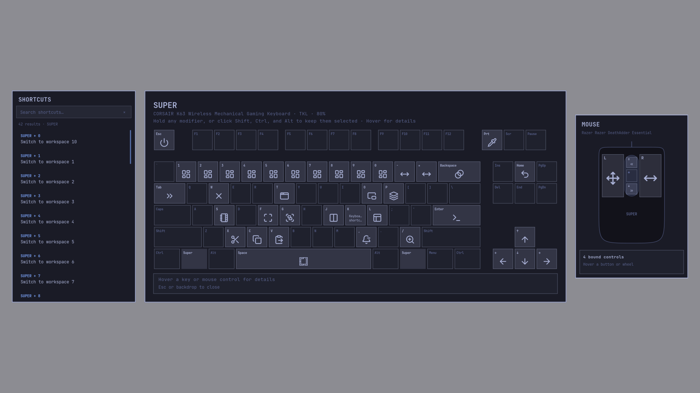

# keywrld

`keywrld` is a keyboard-shaped system shortcut overlay for Hyprland and
Omarchy. It reads Hyprland's live binding registry, using Omarchy only to
recover keys omitted from Lua-backed registry entries. App-local shortcuts and
unmodified dedicated keys whose function is already printed on the keyboard
are left out.

The view follows the modifiers that are actually held, so bindings without
Super are visible too. Shift, Ctrl, and Alt can also be clicked to keep them
selected; Super is never latched. A mouse diagram beside the keyboard follows
the same modifier selection, highlighting its bound buttons and scroll wheel.



Demo, showing fuzzy search, multiple modifiers, hover details, and scrolling through shortcuts:

https://github.com/user-attachments/assets/60ed4653-dc98-403b-926f-6789111ab857

## Runtime requirements

- Omarchy 4 / Hyprland on Wayland
- GTK 4
- GTK4 Layer Shell

## Build

Arch packaging and AUR release instructions are in
[packaging/arch/README.md](packaging/arch/README.md).
Use `scripts/release.py prepare VERSION` to prepare a release and
`scripts/release.py publish` to publish it on GitHub.

```sh
cargo build --release
install -Dm755 target/release/keywrld ~/.local/bin/keywrld
```

Add keybinding override:

```lua
hl.unbind("SUPER + K")
o.bind("SUPER + K", "Keyboard shortcuts", { launch = "keywrld" })
```

Hyprland configuration changes should be checked with:

```sh
hyprctl reload
hyprctl configerrors
```

## Usage

```text
keywrld [--layout auto|full|100|tkl|80|75|65|60]
```

Device detection prefers an exact USB profile, then model-name hints, then
input capabilities. `--layout` is available when hardware metadata is
ambiguous. Escape, a backdrop click, or invoking the app again closes it.

## Shortcut search

The separate search panel initially lists all registered keyboard and mouse
bindings across every modifier combination, including keys absent from the
detected layout. Type immediately to fuzzy-search action descriptions, key
names, and modifier labels. Each word narrows the results; exact and contiguous
matches appear before scattered matches. The first result is selected when the
search text changes. Use Up/Down to select another result, wrapping at either end;
the list scrolls to keep it visible. Press Enter to close the overlay and execute
its command. Empty searches and searches without matches do not execute anything.

Holding or latching modifiers filters the list to that exact combination.
Releasing held modifiers and clearing latched modifiers restores all combinations.
Clear the search field to remove the text filter. Scroll over the results
independently of the touchpad panel, and hover a row for its full chord and
description. Clicking results does not run actions.
In landscape layouts, search stays outermost left when the mouse diagram is also on the left.

## Appearance

The whole overlay shares one style, refreshed each time it opens. Omarchy's
`omarchy theme color --all` resolves the current palette, including legacy color
aliases and derived shades. The theme comes from
`$XDG_STATE_HOME/omarchy/current/theme` (default
`~/.local/state/omarchy/current/theme`).

The theme's `shell.toml` supplies menu surfaces, backdrop opacity, control
states, text sizes, and list spacing. User overrides in
`$XDG_CONFIG_HOME/omarchy/shell.toml` (default `~/.config/omarchy/shell.toml`)
take priority, including the text size set by Omarchy. All panels use Omarchy's
`monospace` fontconfig alias. Keyboard legends and mouse-diagram text keep
sizes fitted to their geometry.

Live Hyprland rounding and border width supply panel geometry; its active
border color fills a missing theme border. Search, keyboard, mouse, and touchpad
share the same surface and control drawing helpers. Canonical `foreground`
takes priority over `bright_foreground`.

If the Omarchy resolver is unavailable, the app reads scalar palette values
directly. Missing or malformed values fall back to GTK's active desktop theme,
then built-in defaults. Shell color references, alpha values, and scalar border
widths are supported; gradients use their first color. Unsupported values fall
back without preventing the overlay from opening. No system settings are changed.

## Responsive layout

The overlay uses the screen's available size after display scaling. Wide screens
keep search, keyboard and mouse side by side. When this would shrink keyboard
units below 32 logical pixels, the keyboard moves above a row of search, touchpad
and mouse panels, with a shorter header and footer. Search stays outermost left;
a left-handed mouse moves ahead of the touchpad.

Portrait screens put the keyboard across the top, with search beside a column of
mouse and touchpad panels below. That lower arrangement is mirrored for a
left-handed mouse. Missing devices release their space to the remaining panels.
Layouts adapt on resize while preserving the search and selected modifiers;
search and touchpad lists continue to scroll independently.

The readability target is 1280×720 landscape and 720×1280 portrait logical pixels
or larger. Smaller areas receive best-effort fitting. Keyboard diagrams grow up
to 78 logical pixels per unit; display scaling handles high-density screens.

## Pointing-device panels

Mouse bindings appear on a symbolic mouse in a separate panel, with 24-pixel
gaps between panels. On wide screens it sits beside the keyboard. Left/right buttons, wheel click and scroll directions
show action icons (or short text) for the exact selected modifier chord. Hover a
control for its full chord and actions. Thumb buttons and horizontal scrolling
appear when configured, and the diagram stays in place when no bindings match.
The panel moves to the left when the detected mice agree on
left-handed operation. Conflicting or unavailable device settings fall back to
Hyprland's global `input.left_handed` setting, then to the right.

A detected touchpad adds a panel, centered below the keyboard on wide screens. It lists configured
gestures, shared click/scroll bindings, and confirmed tap, clickfinger, button
mapping and scrolling settings. Devices with identical settings share a controls
group. The touchpad list keeps all chords visible; scroll over it to see remaining
rows and hover a row for its complete text. The mouse diagram follows held and
latched modifiers together with the keyboard. Clicking the backdrop, including
the gaps, closes the overlay.

Detection refreshes each time the overlay opens. Hyprland's device registry is
matched to Linux input metadata; touchpads use udev classification with a sysfs
capability fallback. Touchscreens and virtual input devices are excluded. Mouse
bindings remain available even when hardware metadata cannot be read.

Gesture discovery reads configuration files without executing them. Supported
forms are literal Lua `hl.gesture({ ... })` and `hl.device({ ... })` calls, plus
legacy `gesture = ...` and `device { ... }` declarations. Literal `require(...)`,
`dofile(...)` and legacy `source = ...` includes are followed in order; legacy
source paths support variables and `*`/`?` globs. Lua module lookup includes the
XDG state/config directories, `OMARCHY_PATH` (default `/usr/share/omarchy`), and the
main configuration's directory. `require` loads a module once. Gesture `unset`
entries match fingers, direction, modifiers and scale. Callback actions are
labeled “Custom action.”

Conditional registrations, computed declarations, unresolved includes and custom
Lua module-loading behavior cannot be reliably reconstructed. The panel flags
incomplete discovery separately from unavailable configuration and a successfully
read configuration with no gestures. Settings use live global options plus
resolvable static device overrides; changes made dynamically outside those files
may not be represented. App-local and third-party gesture-daemon bindings are
outside this reader's scope. No compositor settings are changed.

For tests and optional Cairo previews (no touchpad or graphical session needed):

```sh
cargo test
KEYWRLD_RENDER_DIR=/tmp/keywrld-panels cargo test render_panel_fixtures
```

## Recording a demo

`scripts/record-demo.py` records a silent 1080p MP4 on a new, empty workspace
on the focused landscape monitor. It types fuzzy searches (`trm`, `brws`,
then `brws shift`), holds multiple modifiers, clicks Ctrl and Alt to latch them,
hovers keys and mouse controls for details, and scrolls the search results.
Typing, pointer movement, and pauses are paced automatically. The examples
use Omarchy's default Terminal and Browser bindings.

Requires Python 3, `hyprctl`, `wtype`, `wlrctl`, `gpu-screen-recorder`, and
`notify-send` for calibration. `wlrctl` supplies mouse input to the layer-shell
overlay; compositor shortcut injection does not reliably reach it.

```sh
cargo build --release
scripts/record-demo.py --dry-run
scripts/record-demo.py --calibrate
scripts/record-demo.py
```

Calibration opens the TKL overlay and asks you to point at each control without
clicking, allowing seven seconds per position. It saves positions to
`target/demo-points.json`; rerun calibration after changing display scaling,
theme spacing, pointing devices, or panel arrangement. The recording also uses
the TKL layout. Use `--points PATH` for a different calibration file.

The recording run gives a five-second countdown, then runs without interaction.
Leave the keyboard and mouse untouched until it returns to the original
workspace. It closes its overlay and finalizes its recorder on interruption,
too. Output defaults to `target/keywrld-demo-TIMESTAMP.mp4`, with recorder
diagnostics in a matching `.log` file. Use `--output PATH.mp4` to choose a new
file, or `--pace 1.3` for slower typing and longer pauses.
